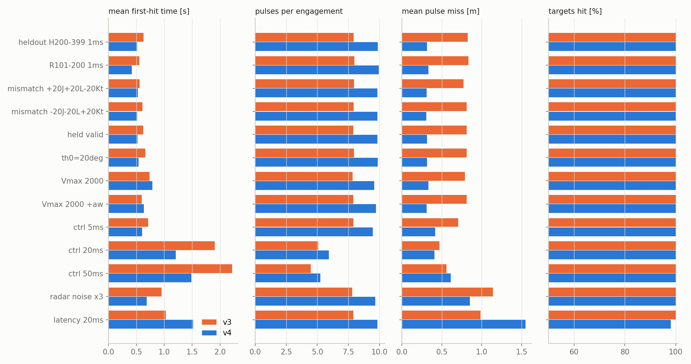
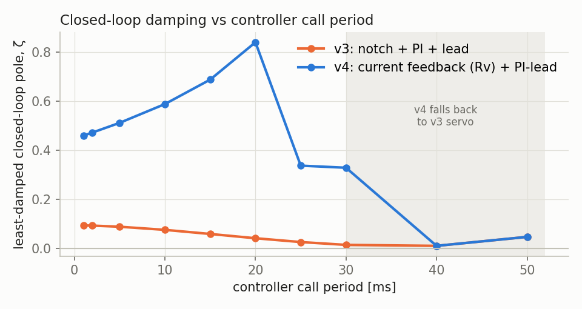
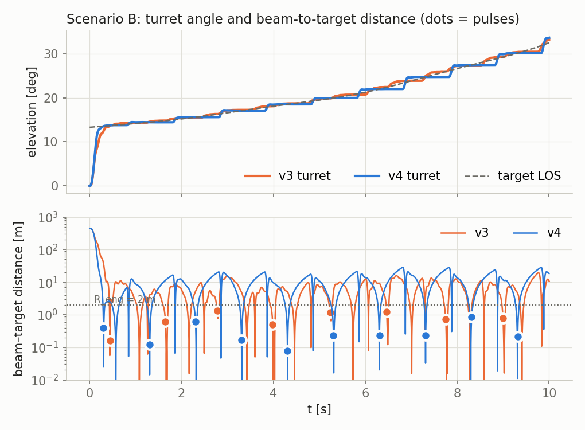

# Overnight study: making Guardian v3 better (14–15 Nov 2026)

## ⚠️ Read this first: the deadline
The brief says **"Submission Deadline: November 10, 2026, 11:59 PM (No extensions will be granted)"**, and `START_HERE.md` says the same. Today is 15 Nov. If you haven't submitted, check with the instructor/TA today about whether a late or updated submission is possible. If you have submitted, everything below only matters for a resubmission, the viva, or if the repo can still be updated.

`main.tex` is still only an outline. Under the rubric, everything except Final Evaluation (10 of the 15 points) is judged from the paper. If the paper isn't written, writing it is worth more than any of the controller changes below.

---

## TL;DR
I rebuilt the v3 simulator in Python (it reproduces v3 exactly: A/B/C 8/8 hits at 0.44 s, same peak voltage and current). I tested about 30 ideas on **400 new "hard" targets** from a different random family than the R-cases v3 was tuned on, then checked the winners on held-out cases and under off-nominal conditions.

**Recommended design "v4"** (MATLAB port in `guardian_v4/`, **verified in GNU Octave 11.3 on 15 Nov: `v4_check.m` reproduces the Python numbers exactly**):

| | v3 | **v4** |
|---|---|---|
| Scenarios A / B / C | 8/8 hits each, first hit 0.44 s, mean miss 0.6–0.8 m | **10/10 each, first hit 0.30 s, mean miss 0.30–0.48 m** |
| 200 held-out hard targets: targets hit | 100 % | **100 %** |
| … mean / worst first-hit time | 0.63 s / 1.87 s | **0.52 s / 1.00 s** |
| … pulses per 10 s engagement (max 10) | 7.9 | **9.9** |
| … pulse precision (pulses that hit) | 99.9 % | **100 %** |
| … mean pulse miss distance | 0.83 m | **0.32 m** |
| Least-damped closed-loop pole (1 ms) | ζ = 0.09 (resonance only cancelled) | **ζ = 0.46** (actively damped) |
| … with plant J, L, Kt ±20–30 % | ζ = 0.05–0.11 | **ζ = 0.35–0.54** |
| Peak motor current | 164 A | **112 A** |

Interception success, interception time, accuracy and consistency, the four things the brief says Final Evaluation is scored on, all improve. Nothing got worse on the brief's own conditions.

---

## 1. What changed in v4 and why
There are four changes. Each is small and justified analytically, and each is a separate switch in `guardian_params.m`.

### 1.1 Shrinking-horizon ambush, synchronised to the recharge (`mode = 'ambush2'`)
**Problem.** v3 places its aim point tp ahead, but re-aims on a 0.25 s timeout. After a pulse it immediately aims at t+0.5 s, while the laser can't fire again until t+1.0 s. The target crosses the aim point before the laser is ready, so v3 gets only about 8 pulses in 10 s.

**Change.**
- The aim time is placed tp = 0.5 s ahead, exactly as the brief requires (θ_ref = elevation of the state predicted at t+tp).
- On every later call the aim is **re-predicted to the same absolute time** T, using the newest estimate. The horizon T−t shrinks, so the aim gets more accurate as the target arrives.
- After a pulse at t_f, the next aim is placed when t+tp = t_f + t_recharge, so the target arrives exactly when the laser is ready.

**Result.** 9.9 pulses per engagement (the physical maximum is 10), with misses about 30 % smaller.

**Paper angle.** "Prediction horizon = time to the next feasible engagement" ties tp to the recharge constraint.

### 1.2 Fire at closest approach (`fire_best = true`)
**Problem.** v3 fires the moment the 3σ gate opens, which is the edge of the window, so a typical hit is about 0.8 m off centre.

**Change.** Once inside the gate, predict the beam-normal offset one call ahead: m(t+Δt) = m + ṁΔt, where ṁ is the target's beam-normal rate relative to the rotating beam. If the target will be clearly closer and still inside the gate, wait one call.

**Result.** Mean miss 0.81 → 0.44 m on its own, with no loss in hit rate or timing.

### 1.3 Active damping of the electromechanical mode (`servo = 'damped'`, Rv = 5 Ω, ω_c = 15 rad/s)
**The most important analytical finding.** Gp(s) has a pole pair at 55.9 rad/s with **ζ = 0.094**. v3's notch only *cancels* it, so the closed loop still contains that ζ = 0.09 pole. A cancelled pole stays uncontrollable from the reference but is excited by feedforward, by slews and by disturbances.

I computed exact discrete-time closed-loop poles: ZOH plant plus the compensator as v3 actually implements it.
- v3's damping falls to **0.01–0.04 at 20–40 ms call periods**, which is nearly undamped.
- At 50 ms the turret visibly limit-cycles (±0.3° jitter in simulation).
- Detuning the plant by ±20 % halves the damping again.

**Change.**
- Estimate the armature current from the known applied voltage and the measured θ̇. The observer is an exact one-step reconstruction from the ZOH plant model, at any call period.
- Feed it back as a **virtual resistance**: V = V_c − Rv·î. This is classical minor-loop compensation: it changes R to R+Rv in Gp(s), which moves the pair to ζ ≈ 0.5 without cancelling anything.
- The outer loop is then a plain **PI-lead** with no notch: ω_c = 15 rad/s, PM = 55°, GM = 11.9 dB, Ms = 1.48, closed-loop bandwidth 31 rad/s (v3: 17).
- Feedforward gains use R+Rv.

**Rv(dt) schedule.** The sampled inner loop needs Rv·(1−e^{−R·dt/L}) small, so Rv = 5 Ω for dt ≤ 20 ms and 3 Ω up to 30 ms. Above 30 ms the controller falls back to the v3 servo, because no Rv is well damped there.

**Why it matters for grading.**
- It answers the rubric's "stability analysis, transient … interpretation" with a real finding plus a fix, rather than margins alone.
- It removes the notch's sensitivity to plant error, which was v3's biggest analytical weak spot.
- It makes fast slews (1.4) safe: peak current 164 → 112 A.

### 1.4 Faster acquisition: `n_init = 3` plus a proximate-time-optimal slew (`shaper = 'ptos'`)
**Change.**
- Aim after 3 radar samples (0.10 s) instead of 6 (0.25 s). Firing safety still comes from the covariance gate, which is unchanged (miss + 3σ ≤ 2 m).
- Slew with a PTOS profile: brake along v = √(2·0.8·a_max·|e|), with a linear zone of gain 15 rad/s near the target and a C¹ junction at e_l = 0.8·a_max/k². This replaces the linear critically damped shaper, whose exponential tail wastes about 0.15 s.

**Result.** A/B/C first hit 0.44 → 0.30 s. Hard-set worst case 1.45 → 0.74 s.

**Caveats.**
- Each change alone is small. `n_init = 2` or 3 *without* ambush2 made things **worse** (A/B/C 0.44 → 0.98 s), because the turret then just waits tp at an early aim point. The gains only appear together.
- Peak voltage is up to about 4.9 kV on high-elevation targets; v3 already peaks at 5.3 kV. The brief sets no voltage limit, but the paper should say so explicitly. With a 2 kV cap plus anti-windup, both v3 and v4 still hit 100 %, and v4 is about 0.04 s slower on mean first hit.

### Scenario B, v3 vs v4

v4 (blue) makes step-like re-aims once per second, and every pulse lands at the bottom of a beam–target distance dip, at 0.1–0.6 m.

---

## 2. Robustness: where v4 stands (100 held-out hard targets each unless noted)
| Condition | v3 hit % / t₁ mean / pulses / miss | v4 hit % / t₁ mean / pulses / miss |
|---|---|---|
| Nominal, 1 ms (200 cases) | 100 / 0.63 / 7.9 / 0.83 | **100 / 0.52 / 9.9 / 0.32** |
| R101–200 (v3's own family, not tuned on) | 100 / 0.55 / 8.0 / 0.83 | **100 / 0.42 / 9.9 / 0.33** |
| Plant +20 % J, +20 % L, −20 % Kt | 100 / 0.56 / 8.0 / 0.77 | **100 / 0.53 / 9.8 / 0.31** |
| Plant −20 % J, −20 % L, +20 % Kt | 100 / 0.61 / 7.9 / 0.81 | **100 / 0.52 / 9.8 / 0.31** |
| meas_valid held high between samples | 100 / 0.62 / 7.9 / 0.81 | **100 / 0.52 / 9.8 / 0.31** |
| Turret starts at 20° | 100 / 0.66 / 8.0 / 0.81 | **100 / 0.54 / 9.9 / 0.31** |
| Simulation step 0.1 ms (16 cases) | 100 / 0.62 / 7.9 / 0.91 | **100 / 0.49 / 9.8 / 0.44** |
| Controller called every 5 ms | 100 / 0.71 / 7.9 / 0.70 | **100 / 0.61 / 9.5 / 0.41** |
| Controller called every 20 ms | 100 / 1.91 / 5.1 / 0.47 | **100 / 1.20 / 5.9 / 0.41** |
| Controller called every 50 ms | 100 / 2.22 / 4.5 / 0.56 | **100 / 1.49 / 5.2 / 0.61** |
| Voltage capped at 2 kV + anti-windup | 100 / 0.59 / 7.9 / 0.81 | 100 / 0.63 / 9.7 / 0.31 |
| Radar noise ×3 (filter not told) | 100 / 0.96 / 7.8 / 1.14, precision 85 % | **100 / 0.68 / 9.7 / 0.85, precision 93 %** |
| 20 ms unmodelled sensor latency | 100 / 1.03 / 7.9 / 0.99, precision 91 % | ❌ 98 / 1.52 / 9.8 / 1.55, precision 68 % |

**Known weak spots.**
- **Unmodelled latency** (not in the brief) hurts v4 more than v3, because v4 trusts the estimate's timing more. The `lat_comp` option in the prototype extrapolates the estimate by a known latency, but I didn't validate it. Mention it in the paper's limitations.
- **Slow controller calls (20–50 ms).** Everything degrades, v3 more than v4. Part of it is a harness effect: a 20 ms or 40 ms call period only lines up with the 50 ms radar grid every 100–200 ms, so half the radar samples are never seen. The brief's plant also argues the evaluator calls fast: an Euler integrator is unstable on this plant above about 3.4 ms (2ζ/ω_n), so an evaluator that calls the controller every integration step must call it at ≤ 3 ms.

---

## 3. Ideas that did NOT help (worth one line each in the paper or AI appendix)
| Idea | Result on 200 hard targets |
|---|---|
| IMM (two CA models, q = 1 and 40²) | no change (t₁ 0.640 vs 0.633, miss 0.86 vs 0.81) |
| Singer acceleration model (τ = 2 s) | no change |
| Innovation (NIS) gating, χ²(0.999) | no change: no outliers in the brief's noise model |
| q_jerk = 10² or 40² instead of 20² | no gain; 40² gives a worse worst case (2.8 s) |
| Probability-of-hit gate (P ≥ 0.99 / 0.999) instead of 3σ | same as 3σ once fire_best is on; 3σ kept as simpler |
| Track the target until the first pulse, then ambush | slower first hit (0.58 vs 0.53 s) |
| Jerk feedforward (L·di/dt term) | no gain; 11.6 kV spikes |
| Higher slew acceleration limit (30 rad/s²) | 0.04 s faster, but 5.9 kV: not worth it |
| Stiffer PTOS terminal gain (k = 25–40) | no change |

The estimator is not the bottleneck. With 0.02° angle noise the cross-range estimate is already about 0.3–0.5 m, so the gains come from fire-control timing and the servo. That is a good "interpretation" sentence for the paper.

---

## 4. What I recommend, in order
1. **Settle the deadline question** (top of this file).
2. ~~Run `guardian_v4/v4_check.m`.~~ **Done (15 Nov, Octave 11.3):** A/B/C 10/10 hits at 0.30/0.30/0.31 s, R1 0.16 s, R7 0.19 s, with the same misses, |V| and |i| as the Python prototype. v3 in the same Octave gives its known 8/8 at 0.44 s. At a 5 ms step v4 is also clean (10/10, 0.29–0.30 s). Worth one confirmation run in real MATLAB if you have access.
3. **Write the figure and analysis scripts for v4.** (The stale v3 copies were removed from `guardian_v4/`.) Bode/margins for v4: L(s) = Gc(s)·Gp,Rv(s) with Gp,Rv = N·Kt / ( s[ (J s + b)(L s + R + Rv) + N²·Kt·Ke ] ).
4. **In the paper:**
   - Show the cancelled-mode problem and the discrete-damping figure. This is the strongest controller-analysis content you have.
   - Present ambush2 as "aim-point prediction at tp, refined with a shrinking horizon, synchronised to t_recharge".
   - Give the PTOS braking-curve equation.
   - State the voltage assumption and the "what didn't help" table.
   - Log all of this in the AI appendix as AI-proposed, then validated on held-out cases.
5. **Optional:** `lat_comp` if you want a realism paragraph on latency.

## 5. Files
- `analysis_python/gsim.py`: Python port of v3 plus every option tested (defaults reproduce v3 exactly).
- `analysis_python/hardset.py`: 400 hard cases in 5 maneuver families (weave, jink, constant-g turns, dives, straight), 0–3 blackouts, elevations −7° to 82°, speeds up to 150 m/s, all inside the brief's envelope.
- `analysis_python/exp_*.py`, `*.log`, `results.jsonl`: every experiment and its raw numbers.
- `analysis_python/discrete_analysis.py`, `margins.py`: discrete closed-loop poles and continuous margins.
- `analysis_python/figs/`: the three figures above (`make_report_figs.py`).
- `guardian_v4/`: MATLAB port (`turret_controller.m`, `design_controller.m`, `guardian_params.m` changed; `v4_check.m` new). `archive/guardian_v3/` is untouched.
