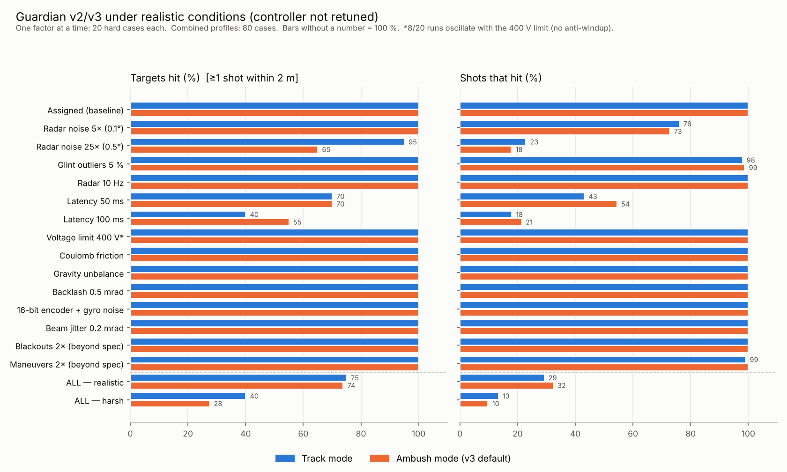

# How would Guardian do in the real world? Assigned vs realistic parameters

*Plain-language summary first, details after. Tested on the v2 controller (identical to v3 except for the default mode) in both modes. The controller was **not retuned**: it still believes the assignment's numbers.*

## TL;DR
- Under the assignment's idealised assumptions, v2/v3 hits **100 %** of 160 hard targets. Real systems aren't 100 % because the real world adds **delays, worse sensors, drive limits, mechanical slop, atmosphere and a much stricter kill condition**.
- When we add these one at a time, two things hurt a lot:
  1. **Sensor latency.** 50 ms of unmodelled delay drops the hit rate to **70 %**; 100 ms drops it to **40–55 %**.
  2. **Radar angle noise worse than the filter thinks.** At 5× the assigned noise, every target is still hit, but only **~75 %** of shots land. At 25× (a typical counter-drone radar spec), only **65–95 %** of targets are hit and **~20 %** of shots land.
- **Drive voltage limits** (400 V) don't stop hits, but they make the turret **oscillate** in 8 of 20 cases (missing anti-windup).
- Friction, gravity unbalance, gear backlash, encoder resolution, beam jitter, 10 Hz radar, 2× longer blackouts and even **2× harder maneuvers** barely matter.
- **With everything realistic at once**, about **75 %** of targets are hit (about a third at a laser-like 0.5 m criterion). In a harsh profile, **28–40 %**.
- The biggest real-world gap isn't modelled at all: **real lasers need several seconds of continuous dwell on a coin-sized spot**, not a 2 m instantaneous pulse.
- All fixes for the two big problems are known: **latency-aware filtering** (time-stamp and predict forward) and **matching or adapting the filter's noise model**. See `IDEAS.md`.

## 1. Why real turrets are not 100 % accurate
A fire-control system's miss is the sum of many small error sources (an "error budget"). Each step of our chain has a real-world counterpart that the assignment idealises:

| Chain step | What the assignment assumes | What really happens |
|---|---|---|
| **Sensing** | Gaussian noise of 0.02°, 20 Hz, no delay, ≤ 0.5 s dropouts | Angle noise is much larger for compact counter-drone radars. **Glint** (the apparent centre wanders as the target turns) and **multipath** (ground reflections) give non-Gaussian errors, worst at low elevation. Data arrives **late** (processing pipelines take 10–100 ms). Update rates can be 10 Hz. |
| **Prediction** | Target ≤ 20 m/s², smooth | Purpose-built evasive drones (e.g. the jet-powered Shahed variants) are designed for higher-g maneuvers and higher speed. |
| **Turret** | Linear motor and gearbox, unlimited voltage, viscous damping only, balanced | **Voltage and current limits**, **Coulomb friction/stiction**, **gear backlash**, **gravity unbalance** (CG not on the trunnion), structural resonances, encoder/gyro quantisation and noise, and parameters that differ from the datasheet. |
| **Beam** | Perfect ray, instantaneous kill if within 2 m | **Atmospheric jitter** (tip-tilt) and platform vibration move the spot. Real high-energy lasers must keep a **cm-scale spot** on one aimpoint for **seconds** (dwell) to burn through; rain or dust stretches that a lot. |
| **System** | One target | Swarms: time spent dwelling and re-slewing on one target limits how many can be engaged. |

## 2. Assigned vs realistic parameters
Realistic values come from public sources where possible (see *Sources*); where none were found, a value is marked as an **engineering assumption** and should be presented that way.

| Aspect | Assigned | Realistic range (what we tested) | Basis |
|---|---|---|---|
| Radar angle noise σθ | 0.02° (0.35 mrad) | **0.1°** (5×); **0.5°** (25×) | Commercial counter-UAS radars quote ≈ 0.5° track accuracy (one reports ≈ 1.5° in elevation) [3,4]. Precision fire-control trackers are better, so 0.1° is a "good tracker" middle case. |
| Glint/multipath outliers | none | **5 %** of samples off by ~10σ | Glint and multipath are classic tracking-radar angle-error sources [5,6]. Rate is an assumption. |
| Radar update | 20 Hz | **10 Hz** | Counter-UAS radars quote 10 Hz track updates [3]. |
| Measurement latency | 0 | **50 ms, 100 ms** | Traditional sensor-to-processor pipelines: 10–100 ms [7]. |
| Blackout | ≤ 0.5 s | **up to 1.0 s** (2×), beyond spec | Assumption: stealth/clutter can last longer. |
| Target accel | ≤ 20 m/s² (≈ 2 g) | **≤ 40 m/s²** (≈ 4 g), beyond spec | Newer jet drones are built for high-g maneuvering [8]. Speeds of 50–140 m/s [8,9] are within the brief's 150 m/s. |
| Drive voltage | unlimited (we peak ≈ 1.3 kV) | **±400 V** | Engineering assumption (typical drive-bus class). |
| Coulomb friction | 0 | **3 kN m** at turret | Heavy elevation drives can be friction-dominated [10]. Value is an assumption (≈ 3 % of peak drive torque). |
| Gravity unbalance | 0 | **10 kN m · cos θ** (≈ 850 kg CG 1.2 m off-axis) | Unbalance torque is a major design load in gun mounts [11]. Value is an assumption. |
| Gear backlash | 0 | **0.5 mrad** | A DTIC study targets ~0.1 mil backlash for tracking mounts [12]. Ordinary gear trains are worse, so 0.5 mrad is moderate. |
| Encoder / rate sensor | ideal | **16-bit** angle, **0.005 rad/s** rate noise | Assumption. |
| Plant parameters | exact | J, L **+10 %**, Kt **−5 %** | Assumption. Typical datasheet/assembly tolerance. |
| Beam pointing jitter | 0 | **0.2 mrad** RMS per shot | Assumption: coarse gimbal without a fast-steering mirror. Atmospheric jitter is a known HEL problem [13]. |
| Kill condition | instantaneous, ≤ 2 m | **≤ 0.5 m** (reported as an extra column) | Real HELs need seconds of dwell on a coin-sized spot [1,2]. We can't model dwell with pulses, so the stricter radius is a proxy. |

## 3. Results: one factor at a time
20 hard cases each (ids 1:8:160, covering all five maneuver families). Everything else stays at the assigned values.
*Hit* = target hit at least once (2 m). *Precision* = shots that hit. *≤ 0.5 m* = % of cases with at least one shot within 0.5 m (the stricter, laser-like criterion).

| Condition | Track: hit / t₁ / precision / ≤ 0.5 m | Ambush: hit / t₁ / precision / ≤ 0.5 m |
|---|---|---|
| **Assigned (baseline)** | 100 % / 0.68 s / 100 % / 100 % | 100 % / 0.73 s / 100 % / 85 % |
| Radar noise 0.1° (5×) | 100 % / 0.92 s / **76 %** / 85 % | 100 % / 1.57 s / **73 %** / 90 % |
| Radar noise 0.5° (25×) | **95 %** / 3.96 s / **23 %** / 25 % | **65 %** / 5.39 s / **18 %** / 40 % |
| Glint outliers 5 % | 100 % / 0.68 s / 98 % / 100 % | 100 % / 0.79 s / 99 % / 95 % |
| Radar 10 Hz | 100 % / 0.75 s / 100 % / 100 % | 100 % / 1.17 s / 100 % / 100 % |
| **Latency 50 ms** | **70 %** / 0.92 s / **43 %** / 30 % | **70 %** / 1.13 s / **54 %** / 50 % |
| **Latency 100 ms** | **40 %** / 1.97 s / **18 %** / 20 % | **55 %** / 2.80 s / **21 %** / 25 % |
| Voltage limit 400 V | 100 % / 1.74 s / 100 % / 90 %, but **8/20 oscillate** | 100 % / 1.76 s / 100 % / 80 %, but **8/20 oscillate** |
| Coulomb friction 3 kN m | 100 % / 0.68 s / 100 % / 100 % | 100 % / 0.73 s / 100 % / 75 % |
| Gravity unbalance 10 kN m | 100 % / 0.68 s / 100 % / 100 % | 100 % / 0.72 s / 100 % / 80 % |
| Backlash 0.5 mrad | 100 % / 0.68 s / 100 % / 100 % | 100 % / 0.73 s / 100 % / 90 % |
| 16-bit encoder + gyro noise | 100 % / 0.68 s / 100 % / 100 % | 100 % / 0.73 s / 100 % / 90 % |
| Beam jitter 0.2 mrad | 100 % / 0.68 s / 100 % / 100 % | 100 % / 0.73 s / 100 % / 90 % |
| Blackouts 2× (≤ 1 s) | 100 % / 0.68 s / 100 % / 100 % | 100 % / 0.77 s / 100 % / 70 % |
| Maneuvers 2× (≤ 40 m/s²) | 100 % / 0.67 s / 99 % / 100 % | 100 % / 0.63 s / 100 % / 80 % |

### What this means
- **Latency is the killer.** In 50 ms the line of sight to a crossing target turns by up to ~5–10 mrad, which is 5–15 m at these ranges. The filter thinks the data is fresh, so it aims behind the target *and* is confident about it, and the gate fires wasted shots. The fix is cheap if the latency is known: time-stamp each measurement and propagate the estimate forward by the latency.
- **Noise mismatch costs precision, not (much) success.** The fire gate trusts the filter's σ, which is computed with 0.02°. With 5× noise the gate is over-confident, so ~1 in 4 shots miss. This is fixed by giving the filter the right noise level, or estimating it online (test below).
- **The voltage limit exposes missing anti-windup.** During the initial slew the PI integrator keeps charging while the drive is saturated, and the turret then swings back and forth (hundreds of metres of beam error in some cases). The gate still only fires when the beam crosses the target, so hits survive, but no real system would accept that oscillation. The fix is standard (back-calculation or conditional integration).
- **Mechanics are a non-issue at this accuracy scale.** At 1–2 km, 0.5 mrad of backlash is 0.5–1 m. The feedback loop (integral action) absorbs friction and the gravity offset. The 2 m engagement radius is generous.
- **Ambush vs track.** Both degrade similarly. Track is more accurate per shot (more shots under 0.5 m). Ambush is more sensitive to very noisy radar (its aim point is a 0.5 s extrapolation, which amplifies velocity noise).

## 4. Results: everything at once
Two combined profiles, 80 hard cases each (ids 1:2:160):
- **Realistic:** σθ 0.1°, 2 % glint, 50 ms latency, 400 V, friction 3 kN m, unbalance 10 kN m, backlash 0.3 mrad, 16-bit encoder, rate noise, J/L +10 %, Kt −5 %, jitter 0.1 mrad.
- **Harsh:** σθ 0.25°, 5 % glint, 10 Hz, 100 ms latency, 300 V, friction 5 kN m, unbalance 20 kN m, backlash 1 mrad, 14-bit encoder, J/L +20 %, Kt −15 %, jitter 0.2 mrad.

| Profile | Mode | Targets hit | Mean first hit | Shot precision | Median shot miss | Cases with a shot ≤ 0.5 m | Runs oscillating |
|---|---|---|---|---|---|---|---|
| Assigned (reference, 160 cases) | track / ambush | 100 % / 100 % | 0.68 / 0.63 s | 100 % / 99.9 % | ~0.4 / ~0.85 m | — | 0 |
| **Realistic** | track | **75 %** | 4.13 s | 29 % | 3.4 m | 30 % | 32 / 80 |
| **Realistic** | ambush | **74 %** | 4.30 s | 32 % | 3.0 m | 33 % | 32 / 80 |
| **Harsh** | track | **40 %** | 5.28 s | 13 % | 7.5 m | 8 % | 42 / 80 |
| **Harsh** | ambush | **28 %** | 4.42 s | 10 % | 7.3 m | 4 % | 43 / 80 |

**Reading it:** with every realistic effect stacked, and the design not retuned, Guardian drops from 100 % to about **¾ of targets** at the 2 m criterion, and to about **⅓ of targets** at a laser-like 0.5 m criterion. In the harsh profile, under half of the targets are hit. The damage comes almost entirely from three factors (latency, noise model, drive saturation with no anti-windup). This is exactly why real systems aren't 100 % accurate, and why they add fine trackers, latency compensation and saturation-aware control on top of the textbook loop.

## 5. Can the design recover? A quick mitigation test
Same 5× radar noise (0.1°), but the filter is told the true noise (`sig_th = 0.1°`), so its covariance, and therefore the fire gate, is honest:

| Filter noise model | Gate | Mode | Targets hit | Mean first hit | Precision | Median miss |
|---|---|---|---|---|---|---|
| Assigned 0.02° (mismatched) | k = 3 | track / ambush | 100 % / 100 % | 0.92 / 1.57 s | **76 % / 73 %** | 1.13 / 1.40 m |
| True 0.1° (matched) | k = 3 | track / ambush | **0 % / 0 %** (never fires) | — | — | — |
| True 0.1° (matched) | k = 1.5 | track / ambush | 100 % / 100 % | **4.68 / 5.09 s** | **94 % / 93 %** | 0.76 / 0.59 m |

**Lesson:** an honest filter fixes the wasted shots, but a fixed "miss + 3σ ≤ 2 m" gate then becomes too strict. At 0.1° noise the 1σ position uncertainty at 1.5–2 km is about 1 m, so the gate only opens once the target is much closer (first hit around 5 s). The gate threshold should come from a **probability-of-hit** criterion, and the noise level should be known or estimated online (IDEAS B4, B5). It's a nice illustration of the speed-vs-certainty trade-off for the paper.

## 6. How to use this in the paper
- Put a short **"Practical considerations"** paragraph in Conclusions, with the one-factor table condensed to the three factors that matter (latency, noise, voltage limit).
- Present the result as *graceful degradation*: what fails first, and why, in control terms (delay → phase lag and stale estimates; mismatched R → over-confident gate; saturation → integrator wind-up).
- Be explicit that the 2 m pulse model is generous compared with real HEL dwell requirements.

## Sources
1. RFE/RL (2026): laser weapons need dwell time; clear-day vs rain dwell example. https://www.rferl.org/amp/iran-ukraine-russia-israel-laser-weapons-future-war/33696183.html
2. Iron Beam (Wikipedia/Wikiwand): beam must be held on target for several seconds; coin-sized spot. https://www.wikiwand.com/en/Iron_Beam
3. Echodyne EchoGuard/EchoShield specs: < 0.5° track accuracy, 10 Hz update. https://www.echodyne.com/media/y1cpgasb/brochure-gov-echodyne.pdf
4. US trade.gov Echodyne profile: elevation accuracy ≈ 1.5°. https://www.trade.gov/sites/default/files/2024-08/ECHODYNE.pdf
5. NRL report on tracking-radar angle errors (glint, multipath, thermal noise). https://apps.dtic.mil/sti/pdfs/AD0725108.pdf
6. MIT Lincoln Lab, "Compensation of Multipath Angular Tracking Errors in Radar" (1974). https://apps.dtic.mil/sti/pdfs/AD0781100.pdf
7. Military Aerospace (2026): traditional sensor-processing pipelines 10–100 ms latency. https://www.militaryaerospace.com/computers/article/55383964/sensing-to-action-in-microseconds-modern-day-defensive-edge-processing
8. TWZ (2026): jet-powered Shahed variants, purpose-built for high-speed, high-g flight. https://www.twz.com/news-features/russias-jet-powered-shahed-drones-are-quickly-evolving-as-ukraine-scrambles-to-blunt-their-damage
9. Shahed-136 cruise ≈ 180–185 km/h. https://www.rifleconfigurator.com/articles/shahed-drone
10. SMA memo 104: elevation drive performance limited by friction. https://lweb.cfa.harvard.edu/sma/memos/104.pdf
11. NDIA 2002: gun unbalance as a dominant stabilisation effect. https://ndia.dtic.mil/wp-content/uploads/2002/gun/johnsonG.pdf
12. DTIC AD0404055: tracking mounts, backlash/friction/windup at a minimum (~0.1 mil). https://apps.dtic.mil/sti/pdfs/AD0404055.pdf
13. US patent 11513191: uncompensated HEL atmospheric jitter reduces power on target. https://image-ppubs.uspto.gov/dirsearch-public/print/downloadPdf/11513191

## Reproduce
In `guardian_v3/realism/`: `eval_real.m` (harness), `real_case.m` (2×-maneuver cases), `run_real.sh`, `batch_real.m`, `summarize_real.m`, `real_chain.sh` (the exact runs above). Data: `realism_results.csv`.
